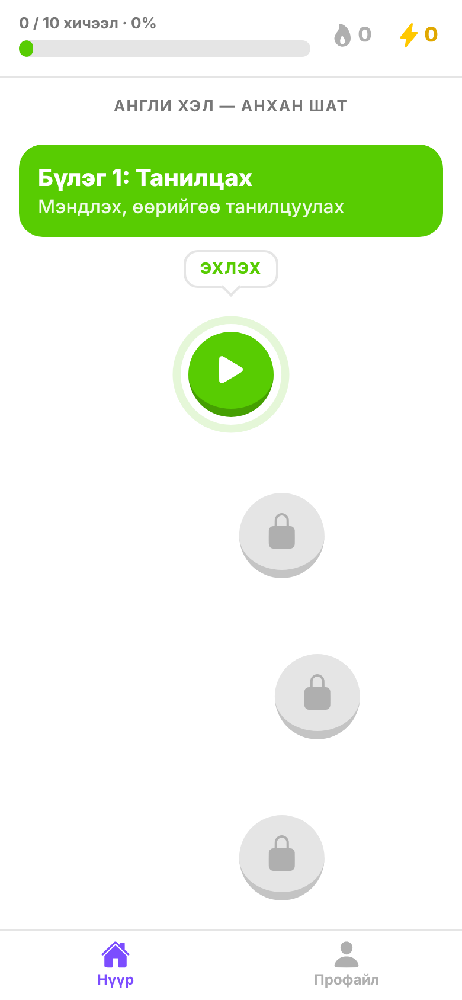
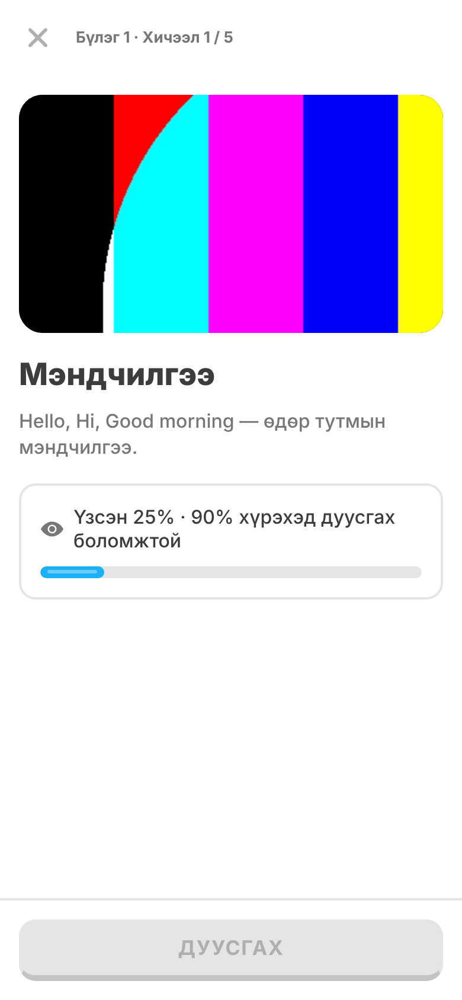
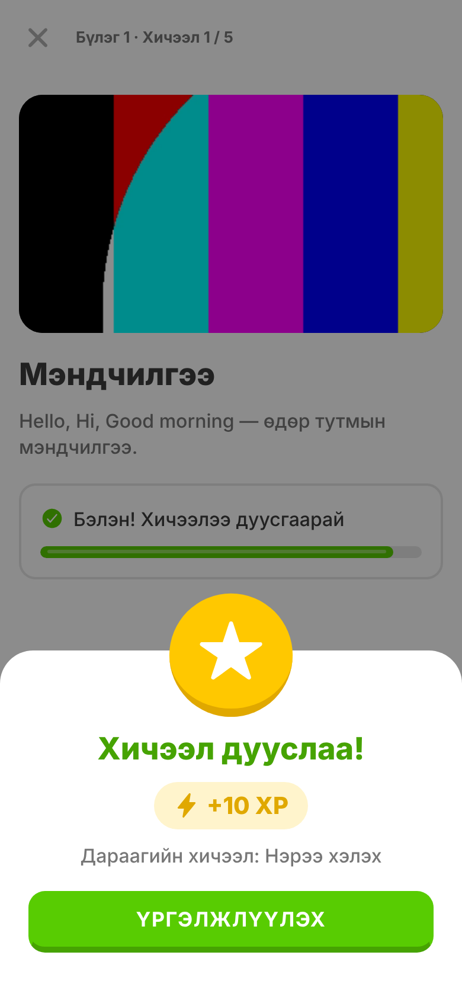
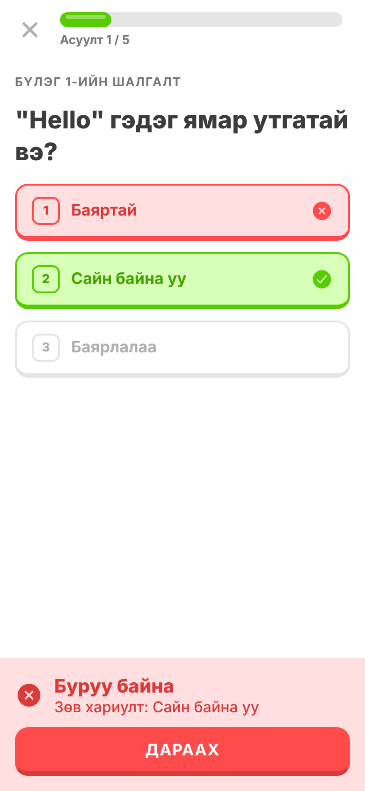

# OctoLearn — Video Course Mobile App (Prototype)

Duolingo-гийн pathway маягийн видео хичээлийн mobile app prototype. Хэрэглэгч бүлэг бүрийн 5 видео хичээлийг дарааллаар нь үзэж, дараа нь 5 асуулттай шалгалт өгнө. Тэнцвэл дараагийн бүлэг нээгдэнэ. Ахиц, XP, streak, түвшин нь дэлгэц дээр үргэлж харагдана.

| Нүүр (Pathway) | Видео хичээл | Амжилт | Шалгалт | Үр дүн | Профайл |
|---|---|---|---|---|---|
|  |  |  |  |  |  |

> Screenshot-уудыг Expo Web хувилбараас (390×844) авсан. Видео хичээлийн зураг дээрх өнгөт тест дүрс нь автомат тестийн орчинд орлуулсан клип юм. Бодит апп дээр course.json дахь видео тоглоно.

## Ажиллуулах заавар

Шаардлага: **Node.js 22+**, утсан дээр **Expo Go** (эсвэл Android emulator / iOS simulator).

```bash
git clone <repo-url> octolearn && cd octolearn
npm install
npx expo start          # QR кодыг Expo Go-оор уншуулна
npx expo start --web    # вэб хувилбар (браузерт)
```

Шалгах командууд:

```bash
npm run typecheck   # TypeScript strict
npm test            # домэйн логикийн unit тест (node:test, 10 тест)
```

### APK build (Android)

```bash
npx eas-cli@latest login
npx eas-cli@latest build -p android --profile preview   # .apk татах холбоос гарна
```

`eas.json` дахь `preview` профайл нь суулгахад бэлэн `.apk` гаргана. iOS-д Expo Go эсвэл `--profile development` ашиглана.

## Технологи

| Хэсэг | Сонголт | Яагаад |
|---|---|---|
| Framework | React Native 0.88 + **Expo SDK 58**, TypeScript (strict) | Нэг кодоор Android, iOS, Web |
| Навигаци | **expo-router** (файлд суурилсан) | Stack (хичээл/шалгалт full-screen) + bottom tabs |
| Видео | **expo-video** | play/pause, seek, fullscreen-тэй native controls; `timeUpdate` event-ээр үзсэн хувийг хэмждэг |
| State | **zustand** + `persist` middleware | Жижиг, boilerplate бага, selector-оор re-render хязгаарлана |
| Хадгалалт | **AsyncStorage** | Апп хааж нээхэд ахиц алга болохгүй (web дээр localStorage) |
| Дүрс | @expo/vector-icons (Ionicons) | Duolingo-гийн ассет ашиглаагүй |

## Архитектур

```
src/
  app/                    # дэлгэцүүд (expo-router)
    _layout.tsx           # Stack + ахиц ачаалах (hydration) хүлээлт
    (tabs)/index.tsx      # Нүүр — zigzag pathway, прогресс бар, XP, streak
    (tabs)/profile.tsx    # Профайл — статистик, түвшин, 7 хоногийн график, reset
    lesson/[id].tsx       # Видео хичээл
    quiz/[id].tsx         # MCQ шалгалт + үр дүн
  components/             # Button, ProgressBar, PathNodeButton, LessonVideo, Toast, ...
  domain/                 # UI-гүй цэвэр логик (types, progress, validate)
  store/progressStore.ts  # zustand store (persist)
  data/course.json        # контент
  theme/                  # өнгө, зай, фонт — нэгдсэн дизайн токен
tests/progress.test.ts    # домэйн логикийн тест
```

Гол шийдвэрүүд:

1. **Контент ба ахицыг салгасан.** `course.json` нь зөвхөн контент. Төхөөрөмж дээр зөвхөн ахиц (`completedLessonIds`, `quizResults`, `xp`, `activity`) хадгалагдана. Контент шинэчлэгдсэн ч ахиц эвдрэхгүй, дараа нь backend-ээс контент татахад хялбар.
2. **Түгжээний төлөвийг хадгалдаггүй, тооцоолдог.** `buildPath()` нь курсийг нэг шугаман зам болгоод: эхний дуусаагүй цэг = *идэвхтэй*, өмнөх нь *дууссан*, дараах нь *түгжээтэй*. Нэг л үнэний эх сурвалжтай тул төлөв зөрөх боломжгүй.
3. **Бизнес логик цэвэр функц.** `src/domain/progress.ts` нь React/RN-ээс хамааралгүй тул Node-ийн built-in test runner-аар шууд тестлэгддэг (нэмэлт dependency-гүй).
4. **Нэгдсэн дизайн систем.** Бүх өнгө, зай, фонт `src/theme`-д. Бүх товч 3D маягийн нэг `Button` компонент, дарах талбар ≥ 48dp.
5. **Төлөв бүрийн UI.** Ахиц ачаалж байх, видео ачаалж байх, видео алдаа (дахин оролдох товчтой), видео байхгүй, түгжээтэй хичээл рүү шууд link-ээр орох, асуултгүй шалгалт гэсэн төлөвүүдийг `StateView`-ээр харуулна.

## Дүрмүүд (шийдвэр гаргасан зүйлс)

| Дүрэм | Утга |
|---|---|
| Хичээл дуусгах | Видеоны **≥ 90%**-д хүрэх эсвэл төгсгөл хүртэл үзэхэд "Дуусгах" идэвхжинэ. Шалгагч хурдан турших боломжтой байхын тулд seek хийж урагшлахыг хориглоогүй. |
| Хичээлийн XP | Анх дуусгахад **+10 XP**. Дахин үзэхэд XP өгөхгүй (farming-ээс сэргийлсэн). |
| Шалгалтад тэнцэх | Зөв хариултын хувь **≥ 60%** (5-аас 3) бол тэнцэнэ, дараагийн бүлэг нээгдэнэ. |
| Шалгалтын XP | Тэнцсэн оролдлого бүрт зөвхөн *шинээр нэмэгдсэн* зөв хариулт тутамд 5 XP (жишээ: 4/5 → 20 XP, дараа нь 5/5 → +5 XP). Нэг шалгалтаас хамгийн ихдээ 25 XP. |
| Дахин өгөх | Тэнцсэн шалгалтыг дахин өгч болно. Дараа нь унасан ч түгжигдэхгүй. |
| Дундаж оноо | Өгсөн шалгалт бүрийн **хамгийн сайн** хувийн дундаж. |
| Түвшин | 50 XP тутамд 1 түвшин. |
| Streak | Хичээл/шалгалт дуусгасан дараалсан өдрийн тоо. Өнөөдөр идэвхгүй байсан ч өчигдрийн streak шөнө дунд хүртэл хадгалагдана. Өдрийг төхөөрөмжийн цагийн бүсээр тоолно. |
| Бүлэг 3 | `comingSoon: true`. Зам дээр харагдах боловч үргэлж түгжээтэй ("тун удахгүй" мэдэгдэлтэй). Дэвшлийн бар зөвхөн нээлттэй 10 хичээлийг тоолно. |

## Хийсэн зүйлс

**P0 (бүгд):** zigzag pathway (2 бүлэг × 5 хичээл + шалгалт, 3-р бүлэг түгжээтэй), 3 төлөвтэй цэг ба ялгаатай шалгалтын цэг (алтан цом), түгжээтэй цэг дарахад toast, дээд прогресс бар ба XP, видео тоглуулагч (play/pause/seek), 90% дүрэм, +10 XP feedback, шалгалт (ахицын бар, ногоон/улаан, зөв хариулт харуулах, үр дүнгийн дэлгэц, Үргэлжлүүлэх / Дахин өгөх), профайл статистик, bottom tabs, AsyncStorage хадгалалт.

**P1:** идэвхтэй хичээл рүү автоматаар гүйлгэх, streak, анимэйшнтэй прогресс бар, видео бүтэн дэлгэц, түвшин, reset товч (баталгаажуулах цонхтой).

**P2:** 7 хоногийн идэвхийн график, Expo Web хувилбар, unit тест, zustand state management, курсийн JSON validation, сүлжээ тасарсан үед видеоны алдааны төлөв ба дахин оролдох.

## Хийгээгүй зүйлс

- Backend (Node.js + SQL), login. Контент JSON-оос уншина.
- Dark mode, Lottie/Rive анимэйшн (энгийн `Animated` API ашигласан).
- Видеог offline cache хийх.
- Шалгалтын дундаас гарахад "гарах уу?" баталгаажуулалт (одоогоор гарахад ахиц тооцогдохгүй).

## Илүү цаг байсан бол

- Node.js + PostgreSQL API: контент, ахицыг сервер дээр хадгалж, олон төхөөрөмж хооронд синк хийх.
- Seek хийж алгасахыг тооцох "жинхэнэ үзсэн хугацаа" (watched ranges) хэмжилт.
- Өдрийн зорилго, түвшин ахих үеийн тусгай анимэйшн, дуу.
- Компонентын тест (React Native Testing Library) ба E2E (Maestro).
- Видеоны offline татаж авах.

## Зарцуулсан хугацаа

_TODO: бөглөнө үү._

## AI хэрэглээ

Энэ төслийг **Claude (Claude Code)**-ийн тусламжтайгаар бүтээсэн: даалгаврын шаардлагаас архитектур төлөвлөх, код бичих, unit тест болон Playwright-аар вэб хувилбар дээр үндсэн урсгалыг (нүүр → хичээл → шалгалт → профайл → reset) автоматаар шалгах, README бичихэд ашигласан. Бүх дүрэм (XP, тэнцэх босго, streak) болон архитектурын шийдвэрийг дээр тайлбарласан.
