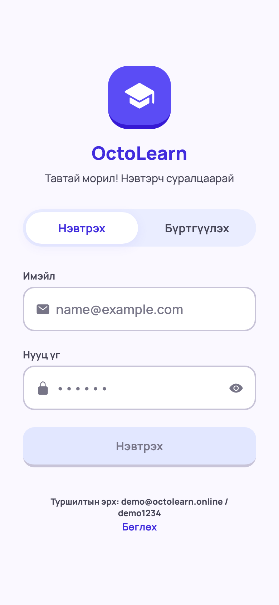

# OctoLearn — Video Course Mobile App (Prototype)

Duolingo-гийн pathway маягийн видео хичээлийн mobile app prototype. Хэрэглэгч бүлэг бүрийн 5 видео хичээлийг дарааллаар нь үзэж, дараа нь 5 асуулттай шалгалт өгнө. Тэнцвэл дараагийн бүлэг нээгдэнэ. Ахиц, XP, streak, түвшин нь дэлгэц дээр үргэлж харагдана.

| Нэвтрэх | Нүүр (Pathway) | Видео хичээл | Амжилт | Шалгалт | Үр дүн | Профайл |
|---|---|---|---|---|---|---|
|  |  |  |  |  |  |  |

> Screenshot-уудыг Expo Web хувилбараас (390×844) авсан. Видео хичээлийн зураг дээрх өнгөт тест дүрс нь автомат тестийн орчинд орлуулсан клип юм. Бодит апп дээр өгөгдлийн сангаас ирсэн видео тоглоно.

## Ажиллуулах заавар

Шаардлага: **Node.js 20+**, утсан дээр **Expo Go**. Утас ба компьютер **нэг Wi-Fi**-д байна.

Апп хичээл, видео, шалгалтын өгөгдлөө **Node.js + SQLite API**-аас татдаг тул эхлээд серверээ асаана.

```bash
git clone <repo-url> octolearn && cd octolearn
npm install
npm run server:install     # server/ хавтасны dependency (better-sqlite3, express)

# Терминал 1 — API сервер (http://localhost:4000)
npm run server             # анх асахдаа server/seed/course.json-оос өгөгдлийн санг үүсгэнэ

# Терминал 2 — апп
npx expo start             # QR кодыг Expo Go-оор уншуулна
```

Апп нь Metro-гийн LAN IP-г автоматаар ашиглаж `http://<таны-Mac-ийн-IP>:4000` руу хандана. Өөр хаяг ашиглах бол (жишээ нь `--tunnel` горим эсвэл deploy хийсэн сервер) төслийн үндсэн хавтсанд `.env` файл үүсгэнэ:

```
EXPO_PUBLIC_API_URL=http://192.168.1.10:4000
```

Хэрэв утас холбогдохгүй бол: Mac-ийн **System Settings → Network → Firewall** дээр `node`-д ирэх холболтыг зөвшөөрнө. Утасны браузераас `http://<IP>:4000/api/health` хаягийг нээж шалгаж болно.

Хичээлийн видеонууд (`server/public/videos/*.mp4`, H.264, 20 сек) нь API серверээс өөрөөс нь `/videos/...` замаар үйлчлэгдэнэ (iOS-д шаардлагатай HTTP Range дэмжинэ). DB-д харьцангуй зам (`/videos/u1-l1.mp4`) хадгалагдаж, API нь хүсэлт ирсэн хаягаар бүрэн URL болгож буцаана. Гадны `https://...` URL ч мөн ажиллана.

`server/seed/course.json` өөрчлөгдвөл сервер дараагийн асалтаар контентыг DB-д автоматаар дахин ачаална (ахиц хадгалагдана). Өгөгдлийн санг ахицын хамт бүрэн шинэчлэх: `npm run server:seed`.

### Нэвтрэх

Апп нээгдэхэд нэвтрэх дэлгэц гарна. Шинэ бүртгэл үүсгэх эсвэл туршилтын эрхээр нэвтэрнэ:

| Имэйл | Нууц үг |
|---|---|
| `demo@octolearn.online` | `demo1234` |

Хэрэглэгч бүрийн ахиц сервер дээр тусдаа хадгалагдана. Гараад өөр утсанд нэвтэрсэн ч ахиц сэргэнэ.

Шалгах командууд:

```bash
npm run typecheck    # TypeScript strict
npm test             # домэйн логикийн unit тест (10)
npm run test:server  # API integration тест (9), in-memory SQLite
```

### API

| Method | Path | Тайлбар |
|---|---|---|
| GET | `/api/health` | Сервер ажиллаж байгааг шалгах |
| GET | `/api/courses/:courseId` | Курс, бүлэг, хичээл, шалгалт |
| POST | `/api/auth/register` | `{name, email, password}` → `{token, user}` |
| POST | `/api/auth/login` | `{email, password}` → `{token, user}` |
| POST | `/api/auth/logout` | 🔒 Токеныг хүчингүй болгоно |
| GET | `/api/me` | 🔒 Нэвтэрсэн хэрэглэгч |
| GET | `/api/me/progress/:courseId` | 🔒 Өөрийн ахиц (эсвэл `null`) |
| PUT | `/api/me/progress/:courseId` | 🔒 Ахиц хадгалах (хуучин `updatedAt`-тай бичилтийг үл тооно) |

🔒 = `Authorization: Bearer <token>` шаардлагатай.

### APK build (Android)

```bash
npx eas-cli@latest login
npx eas-cli@latest build -p android --profile preview   # .apk татах холбоос гарна
```

`eas.json` дахь `preview` профайл нь суулгахад бэлэн `.apk` гаргана. APK нь `EXPO_PUBLIC_API_URL`-аар заасан, интернэтэд нээлттэй (HTTPS) сервер рүү хандах ёстой. iOS-д Expo Go эсвэл `--profile development` ашиглана.

## Технологи

| Хэсэг | Сонголт | Яагаад |
|---|---|---|
| Framework | React Native 0.88 + **Expo SDK 58**, TypeScript (strict) | Нэг кодоор Android, iOS, Web |
| Навигаци | **expo-router** (файлд суурилсан) | Stack (хичээл/шалгалт full-screen) + bottom tabs |
| Видео | **expo-video** | play/pause, seek, fullscreen-тэй native controls; `timeUpdate` event-ээр үзсэн хувийг хэмждэг |
| State | **zustand** + `persist` middleware | Жижиг, boilerplate бага, selector-оор re-render хязгаарлана |
| Backend | **Node.js + Express + SQLite** (better-sqlite3) | Контент болон ахицыг сервер дээр хадгална. Нэг файлтай DB тул суулгах зүйлгүй, дараа нь PostgreSQL руу шилжүүлэхэд хялбар |
| Хадгалалт | **AsyncStorage** | Офлайн cache: ахиц болон сүүлд татсан курс (web дээр localStorage) |
| Дүрс | @expo/vector-icons (Ionicons) | Duolingo-гийн ассет ашиглаагүй |
| Фонт | **Manrope** (@expo-google-fonts/manrope) | Загварт Plus Jakarta Sans байсан ч кирилл үсэггүй тул ижил геометр хэлбэртэй, кирилл дэмждэг Manrope-оор орлуулсан |
| Зураас | react-native-svg | Pathway-н зангилаануудыг холбосон тасархай муруй шугам |

## Дизайн

UI нь Stitch-ээс экспортолсон загвар (`stitch-design.md`) дээр суурилсан. Загварт 4 дэлгэц бий: сургалтын замнал, интерактив тест, хичээлийн үр дүн, профайл.

- Өнгө, зай, радиус, фонтын бүх утгыг `src/theme/index.ts` дотор design token болгон тодорхойлсон. Жишээ нь primary `#412cdd`, secondary `#006c49`, tertiary `#734700`.
- Товчлуур, зангилаа, хариултын карт бүр доод талдаа 4–5px "ирмэг" хүрээтэй. Дарахад тэр ирмэг багасаж, элемент доошоо дарагдсан мэт харагдана.
- Нүүр дэлгэцийн дээд хэсэгт идэвхтэй бүлгийн карт тогтмол байрлана. Замнал нь зигзаг хэлбэртэй бөгөөд зангилаануудыг SVG тасархай шугамаар холбосон. Идэвхтэй зангилаан дээр "Эхлэх" гэсэн шошго гарна.
- Хичээл дуусах болон шалгалтын үр дүнгийн дэлгэц хоёулаа нэг `ResultView` компонентыг ашигладаг. Энэ компонент XP карт, 2 үзүүлэлт, нэг зөвлөгөө харуулна.
- **Dark mode:** апп эхлэхдээ утасны системийн горимыг дагана. Профайл дээрх 🌙/☀️ товчоор гараар сольж болох бөгөөд сонголт хадгалагдана. Өнгөнүүд `colors`-оос авагддаг ба `applyScheme()` тэдгээрийг шинэчилнэ. Модулийн түвшний style-ууд `themed()`-ээр ороогдсон тул горим солигдоход дахин бүтээгдэнэ (`src/store/themeStore.ts`).

## Архитектур

```
src/
  app/                    # дэлгэцүүд (expo-router)
    _layout.tsx           # Stack + ахиц ачаалах (hydration) хүлээлт
    (tabs)/index.tsx      # Нүүр — zigzag pathway, прогресс бар, XP, streak
    (tabs)/profile.tsx    # Профайл — статистик, түвшин, 7 хоногийн график, reset
    lesson/[id].tsx       # Видео хичээл
    quiz/[id].tsx         # MCQ шалгалт + үр дүн
  components/             # Button, ProgressBar, PathNodeButton, LessonVideo, Toast, ...
  domain/                 # UI-гүй цэвэр логик (types, progress, validate)
  app/login.tsx           # Нэвтрэх / бүртгүүлэх дэлгэц
  api/                    # API хаяг тодорхойлох, fetch client (timeout, Bearer token)
  store/authStore.ts      # нэвтрэлтийн төлөв, токеныг SecureStore-д хадгалах
  store/courseStore.ts    # курсийг API-аас татах + офлайн cache
  store/progressStore.ts  # ахицын zustand store (persist)
  store/sync.ts           # ахицыг сервертэй синк хийх (last-write-wins)
server/
  src/db.js               # SQLite schema, seed
  src/repo.js             # SQL query-ууд → апп хүлээж авах JSON хэлбэр
  src/app.js              # Express route-ууд
  src/auth.js             # нууц үг хэшлэх, токен, auth middleware
  seed/course.json        # анхны контент
  test/api.test.js        # API тест
  theme/                  # өнгө, зай, фонт — нэгдсэн дизайн токен
tests/progress.test.ts    # домэйн логикийн тест
```


**P0 (бүгд):** zigzag pathway (2 бүлэг × 5 хичээл + шалгалт, 3-р бүлэг түгжээтэй), 3 төлөвтэй цэг ба ялгаатай шалгалтын цэг (алтан цом), түгжээтэй цэг дарахад toast, дээд прогресс бар ба XP, видео тоглуулагч (play/pause/seek), 90% дүрэм, +10 XP feedback, шалгалт (ахицын бар, ногоон/улаан, зөв хариулт харуулах, үр дүнгийн дэлгэц, Үргэлжлүүлэх / Дахин өгөх), профайл статистик, bottom tabs, AsyncStorage хадгалалт.

**P1:** идэвхтэй хичээл рүү автоматаар гүйлгэх, streak, анимэйшнтэй прогресс бар, видео бүтэн дэлгэц, түвшин, reset товч (баталгаажуулах цонхтой).

**P2:** Node.js + SQLite API (контент болон ахицыг серверээс авах/хадгалах), login (бүртгүүлэх, нэвтрэх, гарах, хэрэглэгч тус бүрийн ахиц), 7 хоногийн идэвхийн график, Expo Web хувилбар, unit тест, zustand state management, курсийн JSON validation, сүлжээ тасарсан үед видеоны алдааны төлөв ба дахин оролдох.

## Хийгээгүй зүйлс

- Нууц үг сэргээх, имэйл баталгаажуулалт, login оролдлогын rate limit.
- Контент засах admin UI (одоо `server/seed/course.json`-г засаад `npm run server:seed`, эсвэл SQLite-г шууд засна).
- Lottie/Rive анимэйшн (энгийн `Animated` API ашигласан).
- Видеог offline cache хийх.


## Илүү цаг байсан бол

- Серверийг deploy хийж HTTPS-ээр ажиллуулах, PostgreSQL руу шилжүүлэх, Google/Apple-ээр нэвтрэх.
- Өдрийн зорилго, түвшин ахих үеийн тусгай анимэйшн, дуу.
- Компонентын тест (React Native Testing Library) ба E2E (Maestro).
- Видеоны offline татаж авах.

## AI хэрэглээ

Энэ төсөлд claude ийг ашигласан UI зурах болон UI ийг өрхөд ашигласан
